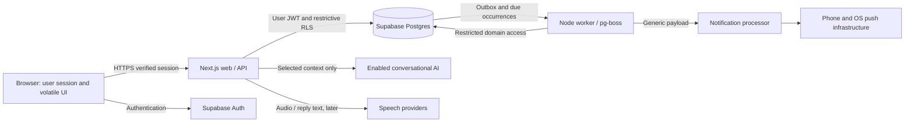

# Personal-version connections — finishing pass, 2026-11-01

The current capability/screen/API/persistence/evidence mapping is consolidated in [STATUS](STATUS.md). This section records only architectural changes; earlier detailed privacy/task/recurrence/voice boundaries remain in force.

`/welcome` reuses the existing Preferences form, ordinary verified session and owner-filtered profile write. Save updates preferences and a completion timestamp in one update; skip updates only the marker. Additive **202610310005_personal_finish.sql**, after all 16 earlier files, backfills existing users and grants UPDATE on that one column to authenticated under existing RLS/admission/live-session/deletion policies. No role, privileged function, admin web credential or worker authority is added. Completion metadata is included in the export's safe profile projection. No generated-schema execution claim; the manual contract labels pending additions provisional.

Integration status combines private owner-bound configuration with owned consent and existing capabilities. It reports distinct unavailable/configured/disabled/consent/ready states, never a key or another account's model/usage. Missing required schema returns a sanitized unavailable response rather than claiming ready. Setup and provider status make no live call. Text AI, transcription and notification sends remain separate; no proactive check-in engine exists. Disabling Pushover sends is not channel disconnection or cancellation, and does not convert old mocks. Due work follows existing bounded authorization/recovery behavior; terminal unknown/failed work is not blindly replayed.

Existing stream requests now abort on local session/privacy events and unmount. View-generation fencing prevents late selection/create/load/stream callbacks from restoring old content. Confirmed sign-in/out broadcasts reload other workspace tabs; a sign-out request merely pauses active work until server confirmation. Restored BFCache views reload through server authorization. BroadcastChannel is best-effort UI invalidation, not a trust boundary. Voice receives the existing stop event; no separate conversation/action authority is introduced. Recent source/epoch checks and compound review RPCs remain authoritative.

Today passes its bounded occurrence list to Series rather than duplicating the reminder GET. Client submit locks supplement, not replace, durable request keys/CAS. No polling/provider call was added for setup or performance. Metadata dates explicitly label UTC; task/reminder schedules retain their own saved IANA zones and full exact confirmation. No latency/mobile/bundle/accessibility measurement is inferred from source. The production build is compilation evidence only.

The static source scanner checks ordered names/default arguments, including renamed delegates and nested default expressions. It does not validate SQL syntax, execute grants, establish ownership/RLS, or prove locks/cascades. Pending 010/recurrence/voice/tasks/privacy/setup must still migrate incrementally and reconstruct separately; new-machine audit and real suites remain mandatory.

---

# Architecture

## Persisted-data inventory and Privacy Center — 2026-10-31

This inventory is **code inspection**, not a current database audit. Earlier deployed evidence and pending migration history remain separate in STATUS. “Implemented” below means present in source; the new migration and runtime behavior have **not executed here**.

| Category | Existing implemented behavior found | Privacy increment / immediate control and limits |
| --- | --- | --- |
| Account/profile/preferences | Auth user/session/admission/revocation records; owned profile with display/assistant names, style, zone, locale. HttpOnly server session, no browser SDK/session store. No prior account-wide erase/export. | Owned privacy preferences, separate consents, recent-password gate, export projection. Account request disables admission and all application RLS access immediately; Auth identity remains until isolated finalization succeeds. Passwords/tokens never exported. |
| Conversations/messages/temporary chat | Owned bounded turns; item conversation deletion cascades messages/proposals. Fixed 30-day `expires_at`, RLS excludes expired history; worker cleanup exists. Temporary content is UI/process memory only. | 7/30/90/365 elapsed-day policy from creation, default 30; warning before shortening. Recalculate only unexpired rows; never revive expired history. Worker deletes one conversation per maintenance batch, including child rows. Bulk history deletion preserves independently approved memories. Export excludes expired sources even before physical cleanup. |
| Memory/proposals/provenance | Exact separate approval, active-only bounded retrieval, item edit/reject/delete, content-free tombstones, derived saved-reply redaction, nullable source links after deletion. No embeddings, summaries or automatic extraction jobs. | Bulk clear active memories/pending proposals immediately, suppress source reuse, redact derived saved replies in batches, retain minimal lifecycle tombstones. Source text remains unless history is also deleted and may still support inference. Expired/deleted source links are masked unavailable in API/export; dates/kinds remain honest. |
| Tasks | Owned title/notes/tagged deadlines, reviews, versions, task operations and optional same-owner one-time reminder links. Item deletion clears content and cancels unsent links. | Export current tasks/reviews/deadlines/links. Bulk task/reminder erase removes content and operation payloads; minimal retired request IDs prevent stale operation replay. Task and reminder semantics remain independent. |
| Series/occurrences | Owned daily/weekly series, occurrence history, schedule/review versions, exact confirmation, skip/snooze/pause/resume/cancel. Generic notification payload. | Export schedules and available delivery/phone-observation history. Explicit bulk erase stops authorization and removes series only after occurrences are gone; in-flight/accepted external notifications cannot be recalled. |
| Outbox/queue/attempts | Private transactional outbox, private pg-boss schema, restricted worker; queue data is owner/reminder/version identifiers, not reminder text. Attempts/acceptance receipts, bounded retry and unknown-outcome handling. Terminal reminder cleanup after 30 days; queue retention depends on its schedule/lifecycle. | Bounded content/queue stages, actual pg-boss job deletion and a rotating orphan sweep reconcile late inserts without deleting newer valid reminders. Authoritative record/version/account checks deny stale jobs even before physical queue cleanup. Queue/outbox internals are excluded from export; friendly delivery history is included. |
| Provider/integration credentials | Owner-bound `.local/live.json` (0600) contains OpenAI/Pushover keys; DB stores flags/binding generation, not provider secrets. `.local/worker.json` is system runtime credential. | Separate text/audio/notification consent enforced before dispatch. Account finalizer removes matching-owner live/evaluation files; preserves other owners' files and rejects unsafe file type/permissions. No provider-side key/account revocation API is implemented; already-loaded process copies may persist until shutdown. No key/token is exported or returned by status. |
| Usage/operations/audit | Numerical AI/audio reservation/settlement ledger with private capabilities, request hashes and provider references; task/reminder/series operation records. No account privacy lifecycle existed. | Export safe numerical own usage, not capabilities/hashes/security diagnostics. Minimal privacy events expire after 30 days; completed deletion receipts after 30 days; failed jobs remain until resumed. Retired UUIDs have no content/hash and remain until account deletion to fence retries. Before identity deletion, unlinked monthly cost totals are kept for 13 months, and the initial-evaluation carry until that policy is retired, preserving existing caps. This is a technical budget purpose, not an invented legal obligation or a guarantee of anonymization. |
| Audio/browser caches | Raw recordings, WAV normalization and unsent transcript are transient; no audio DB/object/files/browser persistent store. Local read-aloud is explicit. Server/API responses are private/no-store; no service worker found. | Export creates no server file/public URL/email. Browser gets a sensitive downloaded JSON file it must protect/delete. Cross-tab privacy notifications stop voice and discard stale views; server epochs, source checks and retired IDs provide the security fence. Existing in-flight/delivered copies cannot be recalled. |
| Logs/developer artifacts/backups | Fixed sanitized application/worker diagnostics; Next request logging disabled. Historical DB audit recorded DDL/error logging with parameter-on-error length 0, not rechecked here. Mailpit, `.local/users.json`, local diagnostics/evaluation, shell/OS logs and Docker volumes are developer/operational boundaries. No application backup automation or tested restore was found. | No content/body/credential logging added. Matching-owner evaluation output is erased with live config. Developer fixture/mailbox/system credential files, OS/Docker snapshots and unknown external backups are outside user-facing deletion; their expiry is unverified. Source archives contain no retained DB/exports/recordings. No automatic backup selective deletion or restore/deletion replay is claimed. |

### Source design and security changes

Additive **202610310004_privacy_center.sql** follows the entire earlier chain, including still-pending 010/recurrence/voice/tasks. No prior migration is edited. New owned privacy preferences and private jobs/events/retired request IDs/unlinked budget totals use restrictive grants/RLS. Ordinary web requests remain publishable-key + verified user session. Guard profile SELECT remains denied: export uses the already verified ordinary-user profile, with other pages read through fixed owner-filtered projections. No new managed-Auth grant, superuser/BYPASSRLS role or queue DDL privilege is added.

A recent password AMR timestamp (five minutes, modest future-skew bound) is checked against the gateway-verified JWT plus the existing live-session check. Token `iat`/refresh and client booleans do not establish freshness. Reauthentication uses the existing password sign-in API with an email obtained from the verified user, replacing only server HttpOnly session cookies. Reauth attempts are capped at five/minute. No password/token is persisted or returned.

Export uses fixed column/category allowlists and owner-scoped UUID keyset pages of 100. Bounds: 10,000 rows/category, 40,000 total, 32 MiB/two minutes, two process slots/one per account and three starts/minute in SQL. Every SQL page rechecks identity, password freshness and privacy generation. Creation cutoff excludes new records, but **this is not a consistent transaction snapshot**: concurrent edits/deletes may appear. An interrupted export is explicitly incomplete or a failed stream; UI offers no partial download. Private/no-store/CDN-no-store/no-transform headers, no public URL or server staging file, and bounded transient client Blob cleanup.

Privacy jobs serialize per owner. Normal domain operations take a shared SQL maintenance gate before a shared preferences-row lock; cleanup takes the exclusive gate before row locks. No lock spans filesystem, pg-boss enqueue or provider/Auth network calls. Bulk deletion increments an epoch, blocks new content actions while pending, rejects stale turns and requires a live owned source in the same transaction as model proposals. Retired request IDs prevent replay after parent records/operation receipts are erased. Schema/profile/session/admission ownership boundaries remain intact.

Account workflow: explicit phrase + recent authentication → durable job/access disablement/provider gates → bounded worker cleanup (waiting for valid sending leases, preserving uncertainty) → pg-boss cleanup/orphan reconciliation → **waiting external** → isolated finalizer removes owner-bound local files, moves numerical cost totals atomically, clears remaining profile presentation fields and calls supported `auth.admin.deleteUser(..., false)` → verify Auth identity absence → completed receipt. Cascades then remove remaining owned lifecycle metadata/admission/revocations. The finalizer uses the existing local operator/service-role capability only in its separate Node process, never ordinary web or reminder worker requests. Its SQL helper accepts only an existing account-deletion job/lease, not an arbitrary owner ID, and is executable only by postgres. Bounded retries (eight automatic failures, exponential 10 seconds–one hour; explicit resume after exhaustion) preserve completed stages. A crash after Auth deletion is retried idempotently; no success after partial failure.

Account access is blocked through admission/RLS even for captured access tokens, not merely by cookie removal. A separate HttpOnly receipt (256-bit random secret, hash only in DB, Secure over HTTPS/SameSite Lax) exposes **only progress/counts/timestamps/fixed recovery codes**, including after identity erasure. Its narrowly scoped public RPC permits anonymous receipt checks/retrying the same already-confirmed erasure, not content reads or a new deletion. A verified still-live Auth session can recover its own pending status if the initial response was lost; after that session/receipt is lost the local operator must inspect minimal job metadata. This is an intentional status-only exception, not application access during deletion.

Retention is durable DB expiry plus the existing worker maintenance path (one conversation, up to 50 old proposals/20 terminal reminders/100 uncertain usage rows per batch). Parent deletion may cascade multiple bounded-personal-data children; latency/load still needs runtime measurement. Expired content is denied before cleanup. Approved memories have no automatic expiry. Retention/erasure events record counts/timestamps only. Privacy changes do not silently change mock/live channels; disabling text AI does not cancel confirmed reminders. Notification consent remains separate, and already-authorized effects may still arrive.

Before restoring an older backup, keep web/providers/workers/finalizer off, preserve a newer encrypted deletion/consent/budget ledger separately, apply current migrations, reconcile completed/pending erasures, retired requests, revoked access, expired sources and queued work, then prove isolation/no-replay with mocks before enabling a single worker/provider. **No such backup automation, expiry guarantee or restore rehearsal has been implemented or executed.** A backup without newer deletion state must not be activated as though erased content is safe to serve.

Official sources reviewed **2026-10-31**: [Supabase JWT AMR fields](https://supabase.com/docs/guides/auth/jwt-fields), [password sign-in](https://supabase.com/docs/reference/javascript/auth-signinwithpassword), [server-only Auth deletion](https://supabase.com/docs/reference/javascript/auth-admin-deleteuser), [OpenAI endpoint data controls](https://developers.openai.com/api/docs/guides/your-data), [Pushover privacy](https://pushover.net/privacy). OpenAI Responses uses `store:false` here; that is not a blanket zero-retention promise. The transcription endpoint has a distinct documented retention row, not inherited Responses settings. Actual provider account controls/exception handling/physical erasure remain outside app enforcement. Pushover keeps provider/device copies under its own policy; normal-priority acceptance is not proof of phone arrival or recall.

## Focused personal tasks — 2026-10-31 (source; runtime unverified)

`public.tasks` is distinct from reminder occurrences. It stores owner/title/notes/state/version, exact proposal/review version, optional linked reminder and separately reviewed candidate. Deadline is a tagged union: none; calendar `date` + saved IANA zone; or local datetime + zone + validated UTC instant + explicit clock resolution. A date-only value has **no UTC instant**. It becomes overdue when the saved-zone calendar day exceeds the due date; exact is overdue at `due_at <= now`, and none is never overdue. Closed/draft rows are not overdue. Preferred/device zone changes do not rewrite rows. Gaps reject; folds require earlier/later. Past deadlines within ten calendar years are allowed, future limited likewise. Display is grouped using a server clock snapshot with elapsed local monotonic time; authoritative overdue retrieval uses DB time.

`task_operations` scopes request UUID/hash to verified owner, stores no title/notes/review body, and keeps minimal result/state/version/IDs after task deletion. Source task focus in conversations has a matching-owner FK. Owned SELECT/RLS and narrow `task_command_v1` / `task_context_v1` functions use the existing guard owner, fixed empty search_path and verified owner/admission/live-session helper. No direct user writes or admin web client. Worker has no task-table read or task-helper access; only its existing capability is wrapped. Limits: 1,000 tasks/account, 30 operations/minute, text 120/2,000, body 16 KiB. Existing private Auth/session helper is unchanged.

Task reminder review creates a **new one-time** generic `Task reminder` draft through the existing deterministic operation. `(reminder_id, owner_id, task_id)` plus task-side composite references bind both owner and exact task; series rows cannot be task links. Reviewing does not cancel the old linked reminder. Exact current task/review/reminder snapshot and previous reminder version are required to atomically confirm the replacement and cancel unsent old work. Channel is explicitly selected and credential generation remains checked by the original reminder RPC. Date edits never move notifications. Task complete/cancel/delete cancels unsent links in the same transaction; reopening creates no schedule. Cancelling/removing a reminder keeps its task; physical cleanup SET NULLs the task pointer, keeping the task. Ordinary removal is cancel/detach, not erasure of attempts.

Task mutation and worker claim/authorization lock **task → reminder → attempt**; web mutations also take the existing per-owner operation advisory lock first. They do not lock existing outbox rows after reminder locks. New cancellation events are durable; queued stale versions recheck authoritative task/reminder state. No transaction spans provider calls. Completion that wins before authorization denies sending; a send already authorized/in flight cannot be recalled and its real outcome remains recorded, including unknown without blind replay. Provider acceptance never mutates task completion. Deleting a task first cancels pending work, then removes content and nulls historical links; generic delivery history and minimal operation hashes remain. Exact database lock/FK/race behavior is **written—not executed**.

The existing chat/SSE/voice path receives a strict task proposal with a human title reference, never an invented execution ID. Known commands work deterministically without AI, but create/edit/status/delete proposals still require exact Today review; schedule confirmation and deletion are separate explicit controls. Relevant owned context is bounded to eight titles/status/deadline/version references and current owned focus, omitting notes. Duplicate/truncated matches clarify; weekday-only deadlines clarify a full calendar date. Interrupted turns recover their committed domain receipt before rebuilding CAS arguments; existing turn dedupe binds request UUID to text. Success receipts come only from committed operations. Temporary chat neither retrieves task context nor persists actions. Voice text gets no additional privileges.

At that task checkpoint no bulk export/full-account wipe existed. The later Privacy Center above implements app coverage in source; backup/deletion replay and runtime acceptance remain unverified. Task content has no automatic expiry until deletion; approved memory lifecycle and 30-day conversation history remain distinct. No new content logging, external task database transmission, queue, provider, dependency or infrastructure.

## Push-to-talk / local read-aloud — 2026-10-31 (runtime unverified)

The existing Assistant owns the transcript/composer and conversation turn IDs. `VoiceInput` is a transient input device: Start → permission → recording → Stop/audio ready → explicit Transcribe → review/edit → Use transcript → ordinary Send. No audio route invokes model actions, memory approval, reminders or queue code. Temporary mode uses the same ephemeral review, with numeric accounting metadata but no audio/text persistence. Existing typed message validation and exact action confirmation remain authoritative. Synchronous request guards plus conversation-keyed mounts/generation fencing prevent double work and late transcript insertion after conversation change/sign-out. Typing stays enabled during capture/transcription and reply generation.

`VoiceCapture` stops tracks, detaches recorder callbacks, invalidates delayed permissions/events, and cancels on hidden page/navigation/unmount/sign-out. It never auto-resumes. A visible timer is not a live-region timer announcement. Explicit controls avoid hold-to-record. Capture is 60 seconds / 2 MiB encoded data. Runtime MediaRecorder choices are WebM/Opus or MP4/AAC supported by the browser; local AudioContext/OfflineAudioContext converts to mono 16 kHz PCM16 WAV. A short encoder tail is disclosed/trimmed to 60 seconds; grossly overlong/empty/unsupported capture fails. No FFmpeg/media dependency or disk staging is needed. The server accepts only a canonical 44-byte WAV header and exact sample payload, deriving 0.2–60 seconds from format/rate/data length, not a client estimate. It rejects compressed uploads/extra metadata chunks. This intentionally narrow format avoids trusting container duration metadata or an unbounded server decoder.

The binary `/api/v1/voice/transcriptions` path retains exact Origin/Fetch-Site and verified-session/profile checks and private/no-store responses; only its MIME is audio/wav. Bound private config plus separate user cloud preference gates live use; a final identity check precedes returning text. A bounded reader stops over-size/slow uploads, four process slots bound allocations, SQL limits paid concurrency/rate across processes. Upload/SDK/client timeouts are 20/25/55 seconds (provider-stage signal 30); cancellation is passed to SDK. Audio/File/HTTP buffers are transient; owned arrays are zeroed/references released and AudioContext closed, no object URLs or temporary files. Browser/SDK/OS copies are garbage-collected; this is not secure physical erasure. No audio/transcript/HTTP body/content logging or persistence was added. Next request logging remains off. Permissions-Policy changes microphone from deny-all to `(self)`; camera/location remain disabled. No capture happens on page entry or without a gesture.

New `voice_preferences` is default-off, owner-filtered, no direct mutation; its narrow RPC records exact consent version. Private personal integration flag and optional local config flag enable the personal transcription key independently of text model selection; no API key in browser/API response. `voice_reserve_v1` inserts duration metadata in existing `ai_requests`, under the same global lock/scope/monthly sum as text. One unique voice request ID per owner prevents paid replay even when the transcript is deliberately not retained. Ambiguous network retry may receive “already used”; recording again is an explicit new potentially billable action, not silent replay. `voice_account_v1` validates private server capability and own record; text wrappers refuse audio settlement/reservation so zero token prices cannot bypass duration cost. Only numerical metadata persists. Existing text delegates remain private and runtime worker permissions do not expand.

Fixed gpt-transcribe price version is 2026-10-31; INR conversion/caps are unchanged. A full-minute INR 1 reserve exceeds current estimated INR .675; reconcile reported duration or hold the full reserve on uncertainty/cancel after dispatch. One transcription/account, four/minute and two shared active AI requests; no contingency increase. Prices expire pending review. No SDK retry/fallback; no `store:false` parameter is applied to the audio API because the Responses setting is not its contract.

`SpeechOutput` is a small output adapter boundary with browser synthesis only. Completed replies alone expose an explicit Read aloud control; voices must be browser-reported local and selected/suitable. No remote default fallback. Strip code/URLs/Markdown, bound 2,000 characters and 45 seconds, display truncation, 0.8–1.2× page-only rate. Locality is an OS/browser indication, not an independently validated routing guarantee. Navigation/sign-out/new recording interrupts playback. Automatic playback is off. Physical capture, local voice behavior, interactive accessibility and live endpoint/account availability remain deferred; offline tests do not certify them.

## Recurrence and snooze increment — 2026-10-31 (source, runtime unverified)

`public.reminder_series` stores owner, immutable-by-device-change zone, daily/weekly calendar intent, policy, version/review version, state and generation cursor. Existing `public.reminders` become individual occurrences via matching-owner composite FK; null series fields preserve one-time compatibility. Unique `(series_id, series_version, occurrence_date)` is the logical occurrence identity; edits/resume produce a new schedule version while preserving old rows, operations and attempts. `series_operations` holds owner-scoped request hashes/idempotency results. Only owned SELECT and narrow guard-definer RPCs are exposed; direct writes, API access to worker/delegates and runtime DDL stay denied.

Temporal builds previews and bounded worker batches using ISO calendar dates/weekday arithmetic. Persisted policy `shift_gap_forward_fold_earlier_v1`: a gap shifts the requested wall time by the transition duration (02:30 → 03:30 for a one-hour gap, not 03:00); a repeated time picks the earlier instant once. Subsequent dates return to the selected wall time. Show actual local/UTC/offset/adjustment for the next three dates, or all dates remaining before an inclusive end. SQL independently checks the calendar/zone mapping. Host/DB tzdb disagreements fail closed for that series and produce fixed diagnostics; they must be resolved before accepting its schedule. The inverse check is bounded but its CPU cost and transaction latency still need runtime measurement.

Confirmation atomically activates the exact current review, invalidates unsent old-version occurrences and creates the first occurrence, operation and outbox. Credential-generation changes invalidate live reviews; new occurrences inherit the confirmed series channel generation. Old mocks never change channel. The worker rotates at most ten series/sweep, validates at most 32 historical candidates/series, and materializes at most one future occurrence. Advancement follows nominal calendar due time even if the previous send fails or is unknown. Each transaction locks the series and commits cursor + unique occurrence + operation + outbox together. No DB lock crosses a provider call. Private isolated series test controls exclude test rows from ordinary workers and ordinary rows from test workers.

The recurring lateness window is **5 minutes by default, configurable 1–60 in the confirmed schedule**. Old unsent occurrences become `missed`; historical dates are recorded in bounded batches without enqueuing each missed send. Pause invalidates pending work; resume uses the next strictly future calendar date/time and does not replay paused dates. Cancel/edit retain history and invalidate unsent work. Skip applies only to the selected current next pending occurrence, retains it as `skipped`, and advances the cursor without changing calendar intent. One-time catch-up remains 24 hours. Existing live burst/day caps still apply; this feature does not raise them.

Snooze updates **the same occurrence ID**, preserving `occurrence_date` and `nominal_due_at`; durable operation/attempt history records the change. Presets add 10/60 minutes to the later of now/current due time. Custom snooze uses the occurrence's fixed zone and existing explicit one-time gap/fold validation. It must move later, be within 365 days, and be strictly before the following nominal recurrence; otherwise reject and suggest Skip. Only unexpired unsent pending work is eligible: no prior `send_started_at`, acceptance, failed/unknown/terminal outcome or inactive/old series version. Snooze increments the occurrence version, clears stale queue identity, and atomically emits schedule/cancel outbox events. It does not move the series cursor or create a second logical occurrence. The nominal date plus operation result preserve audit history.

Dispatch authorization and series operations share series→reminder→attempt lock ordering. Existing outbox rows are not locked after reminders during user mutations; the enqueuer's outbox→reminder ordering remains safe. State/version fences reject stale queued jobs, with durable cancellation events clearing old jobs. A send already authorized/in flight may still be accepted after pause/edit/cancel; its actual outcome is retained, never called recalled. Unknown post-send outcomes never trigger blind replay. Next scheduling is independent of that uncertainty. Existing generic lock-screen payload, personal owner binding and restricted worker/provider adapter remain unchanged.

Only daily and selected weekdays are implemented. That recurrence increment added no cron parser, monthly/yearly rules, task model, new queue/service or model execution authority; the later focused task increment is documented above. Source tests verify calculations and mocked boundaries; DB/RLS/atomicity/worker/browser/live evidence is deferred, not replaced by these tests.

## Independent stabilization — 2026-10-31

The current user instruction defers local Docker/database/live work to a new machine. No Auth/session/RLS/ownership or budget architecture was redesigned. A small worker `delivery.ts` function isolates existing channel routing so queued mocks stay mock, foreign-owner/test-mode live attempts are denied and post-send recording errors remain unknown. It is still called only after database dispatch authorization. Offline fixtures exercise this boundary; real worker/RLS proof remains pending on the new machine.

The Responses adapter now handles documented refusal deltas, empty completed responses and fixed allowlisted recovery reasons without raw SDK/driver text. App receipt fields remain deterministic, separate from model text. Source/mocked checks and build pass, not connected-service acceptance. Reconstruction's read-only preservation fingerprint includes M2C budget/policy/acceptance records; its runtime remains unverified. Source transfer and optional retained-data handling are separated in MACHINE_HANDOFF; physical restore and complete account lifecycle controls are not implemented guarantees.

## Current M2C implementation boundary — 2026-10-29

M2C is authorized for local OpenAI conversation and personal Pushover within the recorded budget. Older mock-only/no-live statements below describe earlier increments. The application and Supabase remain loopback-local; selected context goes to OpenAI and a generic message goes to Pushover only after private configuration. No hosting, voice, public signup or unrelated integrations are enabled. Live acceptance/model selection are pending; [STATUS](STATUS.md) is the execution ledger.

Private `.local/live.json` (0600) holds one admitted owner and server-only credentials. The database holds owner binding, enablement flags and a credential-generation hash, not provider secrets. Ordinary web requests still use the verified user JWT, restrictive grants/RLS and owned RPCs; no admin/service credential enters the request path. Configuration/admission are explicit local operator commands. Queue credentials remain separate/restricted. Other synthetic accounts cannot inherit the bound phone/key. Changing credentials invalidates old live channel confirmations; existing mock records retain mock delivery.

`src/worker/pushover.ts` uses a fixed HTTPS endpoint, generic normal-priority text, no supplementary URL, bounded timeout, sanitized codes and no emergency sends. A valid HTTP/JSON acceptance creates a restricted receipt. Phone observation is a separate owned user operation. Known pre-acceptance transient rejection can retry within existing bounds; ambiguous post-send failures stay unknown without blind replay. Account eligibility/cancellation and credential binding are checked before dispatch. No database transaction is held across the external call. The worker remains operational without AI/web availability; local infrastructure/host must remain awake.

The pinned OpenAI **7.45.1** SDK uses Responses streaming, application-managed context, `store:false`, explicit-only caching without breakpoints, one configured model, low reasoning and 1,024 total output tokens including reasoning. One proposal tool/no continuation round, six recent source-filtered user turns and five relevant active approved memories bound context; no credentials/authorization context reach the model. No provider stores, files, embeddings, browser/shell/SQL tools or silent fallback. Temporary text has no durable application content; content-free numeric usage metadata still persists for cost controls. SDK retries are disabled. Cancellation/interruption removes incomplete answer status and conservatively retains uncertain spend.

New public `ai_requests` stores owned numeric reservations/results; safe-column SELECT only, no direct writes. Private prices and synthetic test policies are inaccessible to API users. Serialized reservations cap ₹1,000 per IST calendar month and ₹200 lifetime initial evaluation inside it; uncertain leases retain cost. Server-generated per-request settlement capabilities are never returned, only their hashes persist. They prevent a caller refunding an existing legitimate request by substituting an ID. No new long-lived privileged web database credential is introduced. Price expiry blocks new calls until review; output/cache/reasoning categories are reconciled without double counting. These estimates and provider controls do not establish exact invoice containment.

Live memory proposals carry origin and an explicit owned conflict ID/version. Current-message save intent is validated; the model cannot approve. Separate user approval binds content/version/replacement and rejects legacy-approval bypass. Reminder tool output passes the existing time/DST boundary and creates only an owned review draft; channel comes from configured policy, never model-supplied recipients. App receipts are emitted from committed operations. Approved/deleted/rejected source handling excludes stale proposal history from provider context; approved retrieval is rechecked immediately before sending and commit.

Conversation expiry is 30 days from creation, enforced by owned reads and mutation checks. Bounded worker/self cleanup removes expired sources, rejects seven-day pending proposals and prunes eligible 30-day terminal reminders; independently approved memories survive with nullable source links. Accounting and a generic fixed channel-test readiness record persist. No new summaries/embeddings/provider archives. PostgreSQL old pages/WAL, operator backups/logs and restore deletion replay are separate, unverified physical-retention boundaries. Effective logging audit is recorded in STATUS; live evaluation rejects unverified content-bearing SQL logging. Operator DDL is still within the operator trust boundary.

Additive migrations 006–009 extend existing domain functions/records; migration 010 repairs only the private generic-test helper's intended postgres EXECUTE grant after a deployed permission diagnostic, without changing its guard owner or API/worker grants; applied Auth/session migrations remain untouched. The user reported 006–009 applied with matching bodies and real ordinary-token tests. Repair 010 remains unapplied/unverified after a connection refusal before SQL execution; offline continuation does not change that state. Fresh disposable reconstruction remains unverified behind the unchanged 5 GiB guard.

## Implemented M1 boundary — 2026-10-28

The latest implementation request narrows foundation to authentication, a responsive shell and owned profile/preferences. M1 created one Next.js application under `src/` without worker, queue, outbox, AI calls or future-domain tables. The subsequent authorized M2A increment below adds local text/memory and a mock provider; other future-domain design remains proposed. M1 is **not complete**: software checks pass; the user reports 13 real API/RLS tests and all 10 browser cases passing, including email/password lifecycle after a test locator repair; fresh reconstruction remains storage-blocked; manual screen-reader/real-phone checks are Deferred—not tested until before private beta. Generated types were reviewed and typecheck/lint pass (see STATUS.md).

Local Supabase Edge Runtime is explicitly disabled: M1 uses Next.js Route Handlers and contains no Edge Functions. Auth, database, Data API and local email remain the foundation services; startup retains their health checks.

A follow-up migration corrects managed Auth-table RLS visibility: the restricted guard calls an argument-free private postgres-owned `auth_session_is_active()` boolean function. This narrow privileged function reads Auth state using verified request claims and reveals no Auth rows; API roles cannot invoke it directly. Guard checks still enforce admission and revocation, and profiles still enforce owner identity. The guard has no BYPASSRLS or direct SELECT on managed Auth tables after this migration. The E2 audit confirms deployed metadata/bodies and 13 real API/RLS tests pass; browser email/password lifecycle now passes in the 10-case rerun.

The guard resolves caller sub/session_id from PostgREST's verified transaction-local request.jwt.claims, rather than needing USAGE on the managed auth schema. It accepts no owner/session arguments, and missing/empty claims deny access. Both the access helper and revocation RPC use this path; the privileged boolean bridge independently validates the live Auth session. PostgREST JWT verification and request-scoped settings are part of this trust boundary; arbitrary client SQL or set_config execution is never exposed.

The implemented session path differs from P4's original browser-client proposal: all Auth SDK calls run on the server through `/api/v1/auth/*`, with `@supabase/ssr` cookie storage and **HttpOnly** cookies. No browser Supabase client exists. `SameSite=Lax`, `Path=/`, and `Secure` on HTTPS are explicit; loopback HTTP development (including a local production build) uses non-Secure cookies. This is not a separate session vault: tokens are still stored as cookies on the device, but unavailable through `document.cookie`. E2 browser cases confirm local HTTP flags and JavaScript exclusion; a separate E2 HTTPS runtime harness now confirms Secure/HttpOnly/Lax/Path and JS exclusion as well as A/B sign-in/persistence/sign-out. Its self-signed context and explicitly validated Node certificate are local test evidence, not hosted certificate approval. Real-data/cloud approval remains unresolved.

Proxy refreshes tokens, sets a per-request CSP nonce and private/no-store headers, but does not replace authorization. Protected layouts and preference handlers call verified `getClaims()` and read the profile through user-scoped RLS. RLS also checks the signed session ID against current `auth.sessions`, verified email, active admission and a revocation table. A database RPC can revoke only the caller's current session, and sign-out calls it before clearing Auth state. Ordinary web requests use only the publishable/anon key, never an admin key. No identity field is accepted in preference mutations.

`profiles` stores both display and assistant preferences in one owner-keyed row, eliminating a needless parent/child split. Auth triggers create the row from `NEW.id`, ignoring client metadata. Normal users can SELECT and update only explicitly granted preference columns; INSERT and DELETE are denied. SQL constraints/triggers validate names, bounded tone/locale and IANA timezone independently of Zod. Profile ownership and timestamps cannot be reassigned through the ordinary role.

Personal admission is enforced by a transactional BEFORE INSERT trigger on `auth.users`, backed by `private.admissions`. Unapproved direct Auth signup calls fail even if the UI is bypassed. The trigger atomically claims one operator-approved email and an AFTER INSERT trigger creates the profile; a deferred foreign key ties admission to the actual Auth record. Guard functions are owned by a non-login, non-superuser, non-BYPASSRLS role with narrow grants and fixed search paths. Pending admissions are operator-owned policy records; once claimed they carry the account's explicit owner ID. No public admission-management endpoint exists.

Email confirmation and password recovery use codes entered into same-origin forms; credentials/codes never appear in redirect URLs. Redirect destinations are fixed application paths. Mutation APIs require the configured exact Origin and JSON content type, reject cross-site fetch metadata, cap actual bodies at 4 KB and return generic authentication responses. Supabase provider-side limits apply to direct Auth calls. Production-grade distributed abuse controls remain future work; this executable currently rejects non-loopback backend and application configuration.

Local CLI helpers accept only fixed local commands and verify project/loopback endpoints before setup, test or reset. Admin credentials are obtained from the local CLI only inside synthetic fixture tooling; they are not persisted in app config. Generated passwords go to ignored `.local/users.json` with mode 0600, never console output. The two-user integration suite uses real ordinary user tokens for RLS assertions; its separate admin connection manages only disposable fixture state and inspects catalogs, never supplies isolation assertions. A blocked runtime produces a failing prerequisite, not a simulated pass.

Stabilization audit (2026-10-29 IST): the user's read-only E2 audit confirms both migrations applied, all six bodies match source and intended owner/grant restrictions hold. The corrective migration was not edited or applied during this stabilization run. Ordinary request diagnostics emit static operation names and allowlisted SQLSTATE/category/schema only. Browser/database suites own random synthetic aliases and clean only their run's records; retained accounts/preferences are not their fixture store. Remote/TCP Docker contexts and unapproved CLI flags are refused. The cookie adapter now explicitly distinguishes read-only Server Components from writable handlers and propagates handler write failures. The two failing email tests matched Next's route announcer alongside the correct form error; only their locator was narrowed, with no authorization changes.

The rest of this document is the long-term proposed architecture. References below to an M1 worker/queue spike or browser-readable SSR tokens are superseded by this section and the latest IMPLEMENTATION_PLAN.md M1 scope. Standard Supabase SSR's browser-client exposure remains relevant if a browser client is introduced later; it must not silently replace the current HttpOnly design.

The foundation migration creates a non-login, non-superuser, non-bypass guard role, or rejects unsafe attributes on an existing role. Only the migration executor receives explicit SET membership. Function grants are completed before ownership transfers; temporary schema CREATE rights for those transfers are revoked at migration end. No ordinary application role receives guard membership. The SQL privilege repair is documented in DECISIONS; its deployed state is confirmed by the user-reported E2 audit and integration execution, not agent access to the restricted Docker socket.

Proposed baseline: 2026-10-27. This is a design, not a deployed system. Requirement/default/fact statuses and dated official sources are in [DECISIONS.md](DECISIONS.md). Unless explicitly marked as a requirement or verified capability, implementation details below are **provisional defaults** to validate during the relevant milestone.

## Implemented M2A slice — 2026-10-29

M2A is local text conversation and explicit, reviewed memory with **deterministic-mock-v1**. The authorized slice is complete: 69 units, 27 real integration tests, 16 HTTP browser cases and nine HTTPS runtime groups pass; all 14 deployed function bodies match source. Actual environments/dates and preserved M1 gaps are in STATUS. At the M2A baseline no worker/queue/outbox existed. The M2B section below supersedes that absence; live AI, provider network calls, embeddings and actual notifications remain disabled. Ordinary server requests still use the verified user session and user-JWT Data API client; no service-role/admin client was introduced. Existing Auth helpers/migrations were preserved.

### Owned data and mutation boundary

- `conversations`: owner-keyed title/date, capped at 50/account.
- `messages`: one atomic text-turn row containing user input, assistant output/outcome, account-scoped unique request UUID, fenced attempt UUID and 45-second lease. This avoids an empty future operation subsystem; each row represents its user/assistant pair. Cap 200 turns/conversation and 30 new turns/minute/account.
- `memory_proposals`: exact content, owner, source turn/date, pending/approved/rejected/deleted state and revision; one proposal per explicit source turn. At most 50 pending/account.
- `memories`: approved content, source pointers/date, approval/review dates, state/revision and supersession pointer. At most 50 active/account. Nullable composite source FKs preserve owner identity when a conversation is deleted.

Migration `202610290001` adds RLS/restrictive grants and six versioned public domain RPCs. Authenticated callers have owned SELECT only; direct INSERT/UPDATE/DELETE are denied. Mutations use fixed `SECURITY DEFINER` functions owned by the existing non-login/non-bypass guard, with empty search paths and explicit live admission/session checks via a private owner helper. Function arguments never include an owner ID. Composite `(reference_id,owner_id)` FKs bind conversations, source turns, proposals, memories and supersession to the same account. Guard access is limited to these domain tables; no managed Auth grant or app role membership changed. Default PUBLIC/anon/service/authenticator execution is revoked; only authenticated has the public domain RPC grants. Private helpers are invoker-only and not exposed as APIs.

All mutation paths derive identity again in SQL; API validation/authorization is additional. Owner-scoped advisory transaction locks serialize short domain mutations and quota checks. SQL never grants the model execution authority, generic SQL/context-setting or approval tokens. This narrow domain privilege is distinct from admin credentials in a web request.

### Streaming, retries and failure

POST `/api/v1/turns` streams native SSE over fetch. Provider input is bounded: current input 2,000 characters, at most six historical user turns / 4,000 characters, at most five approved snippets / 5,000 characters, assistant name 40 characters. No assistant-derived history is re-fed. Output is capped at 8,000 characters and a 30-second deadline. Request bytes are capped at 24 KiB for the chat endpoint; existing APIs retain 4 KiB defaults. Provider/prompt version is recorded on each retained turn. No reasoning/tools/paid usage exists in this mock.

A retained user turn commits before streaming; assistant text commits only after explicit provider success and a valid database result. Partial output is labeled unconfirmed, kept only in React state and discarded on failure/stop. Failed/cancelled rows retain the user input with empty assistant text. A crash can leave `running`; retry after the lease expires reuses the original row/request and creates a new fenced attempt. Old attempts cannot complete a reclaimed turn. A retry with a changed conversation/input and reused ID fails. Completed/redacted replay never re-runs proposal creation. If the completion frame is lost after commit, retry returns the committed response. Cancellation confirmation can be unknown; the UI says so rather than promising a commit.

No application content is logged. Responses are private/no-store with Cookie variance. Request/provider errors become fixed messages, not raw payload logs. The adapter is server-only, yields delta/proposal/success/failure events, supports AbortSignal and has no network or application execution client.

### Explicit memory lifecycle and retrieval

Only anchored `Remember: …` or `Remember this: …` creates a pending proposal on successful retained-turn completion. This is a documented rule, not general intent understanding. Ordinary statements, quotations containing the command and model guesses do not trigger extraction. Provider proposals never approve; `/api/v1/memories` is a separate authenticated mutation. Editing increments version; approval must match exact current content/version. Rejected/deleted payloads are cleared and cannot be recreated by retrying the completed source request. A future explicit new request remains a separate user action.

Retrieval is owned active-only lexical matching: split query into alphanumeric words of length ≥3, remove a small English stoplist, match literal substrings, order deterministically by update time/ID and select ≤5. It has no embeddings/ranking-quality claim; synonyms, languages, negation and factual equivalence are not understood. `Used approved memories` identifies included snippets. User preferences are supplied separately. Conflicts use the normalized text before the first colon (or entire note if no colon). Approval of an existing key requires the exact active memory ID/version and explicit replacement confirmation. Other semantic conflicts may be missed; user inspection/correction remains necessary.

A user correction is a separately authenticated approval of exact replacement content/revision. Deletion immediately excludes retrieval, clears saved/proposal payloads and redacts saved assistant replies referencing that memory. Relevant tombstones retain IDs/lifecycle/source metadata without the deleted saved payload; original user source messages remain separately retained. No summaries, caches, embeddings or extraction jobs exist. Logical row/payload deletion is not physical secure erasure: PostgreSQL WAL/old pages and operator backups may retain prior bytes. Backup expiry/restore deletion replay remain unverified real-data gates. Previously delivered content in another open view cannot be recalled. A completion commit rechecks referenced memory revisions/state; a concurrent deletion/correction fails completion and discards the view's partial answer. Deleting a conversation cascades its turns/proposals and nulls approved-memory source links; independently approved content/date survives until separately deleted.

### Temporary mode

Temporary POST accepts no retained conversation/source/memory identifiers. It performs session/profile reads but no application content writes, memory retrieval, proposal creation, summaries, logs, persistent browser storage or durable retry record. The mock's memory proposal event is disabled and the UI explains why. Up to 30 pairs stay in volatile React state; only up to three recent user inputs are sent for bounded context. Refresh/close/mode change loses them. Temporary retry is stateless; it has no durable side effect to deduplicate. Auth cookies are unchanged session infrastructure, never a store for temporary text.

Official mechanics rechecked 2026-10-29: [Next Route Handler Web streams](https://nextjs.org/docs/app/api-reference/file-conventions/route), [PostgreSQL fixed-path/definer guidance](https://www.postgresql.org/docs/17/sql-createfunction.html), [composite FK column-specific SET NULL](https://www.postgresql.org/docs/17/ddl-constraints.html). These verify supported mechanics; STATUS records actual runtime evidence. This local prototype is not approval for cloud/real-data use.

## Shape and boundaries

Use one TypeScript repository and one modular application, deployed as a Next.js web process and a separate Node worker. Modules: identity, conversations, memory, tasks, reminders, operations, notification channels, usage, privacy, and provider adapters. The web process owns interactive requests; the worker owns asynchronous work. They share domain types and SQL migrations, not an unrestricted internal API.

| Concern | Preferred design and reason |
| --- | --- |
| UI | Next.js App Router, React, Tailwind, accessible primitives with custom tokens; readable desktop/mobile layouts |
| API | `/api/v1` Route Handlers, Node runtime, Zod input/output contracts; SSE text events over streaming fetch |
| Identity and data | Supabase Auth/Postgres; SQL migrations, restrictive grants/RLS, user-scoped data access |
| Retrieval | Account-filtered structured and full-text retrieval; optional pgvector only after evaluation |
| Inference | Small OpenAI Responses adapter; one configured conversational model; no agent framework |
| Audio | Independent transcription and synthesis adapters, proposed OpenAI then Google Cloud TTS |
| Background work | pg-boss execution machinery; application tables for schedule intent, outbox, operation and delivery evidence |
| Notifications | Pushover personal; Web Push beta/public; explicit channel opt-in and generic lock-screen text |
| Hosting | Provisional paid Render web/worker, managed Supabase data, custom SMTP; no local disk as durable source of truth |
| Delivery and operations | Docker, GitHub Actions, migration checks, structured sanitized logs/metrics; no provisioning yet |

No Redis, Kubernetes, separate vector database, microservices, marketplace, or arbitrary model execution is justified by the initial scope. Foundation dependencies are now pinned in package.json/pnpm-lock.yaml; pg-boss/Temporal are now pinned for M2B; live provider dependencies remain unselected until separately authorized. V5–V12 establish relevant platform capabilities, not complete integration validation.

Browser content, model output, retrieved text and third-party responses are untrusted input. Application servers, database operators, hosting staff with relevant access, and enabled processors are inside the cloud trust boundary. CI can affect production through deployment privileges and therefore needs restricted permissions and environment gates. The future local gateway is a different boundary, not an extension of the cloud worker's credentials.

## Privacy claims and data flows

| Claim | Meaning / proposed cloud-mode position |
| --- | --- |
| Not used for training | Restricts one use of submitted data; says nothing about retention or human/operator access. OpenAI API default is documented in V3; do not generalize it to every processor. |
| Not retained | Requires endpoint/feature/contract-specific evidence across application state, logs and backups. Not a blanket promise here. |
| Encrypted in transit | Require authenticated TLS for browser, database and processor connections; endpoints still see plaintext. |
| Encrypted at rest | Require managed storage/backups encryption and application encryption for integration secrets. Operators with keys can still decrypt. Validate selected plan configuration. |
| Operator cannot read plaintext | Not achieved by this design. The web/worker and relevant processors handle plaintext. |
| Never leaves the device | False in cloud mode, including cloud speech and remote notifications. Only a separately configured local edition can aim for this with all cloud features off. |

Cloud flow: browser sends a message to the web server; the server authorizes it, retrieves a bounded slice of the same account's approved active memory and recent retained conversation, and sends selected context to OpenAI. Selected content can include sensitive information; disclose this before enabling cloud use. Responses return through the web server. Retained messages are stored only under the chosen history policy, independently of memory approval.

Audio later flows from microphone to server to the enabled transcription provider. Edited transcript becomes the user's submitted message only after confirmation. Reply text goes to the enabled synthesis provider and audio returns for playback. Raw audio and synthesized audio are volatile by default; prohibit body capture, persistent upload staging, crash dumps, or content-bearing tracing. If an implementation needs temporary disk staging, it needs a separately reviewed retention change before enabling voice.

Notifications contain a fixed message such as “You have a reminder” and an authenticated application link without task text, bearer credentials, or personal identifiers in the URL. Channel credentials and routing identifiers remain necessary processor metadata. Default link can open Today rather than expose a reminder identifier. Email authentication also exposes recipient metadata to the SMTP processor.

Use foreground Responses with `store: false` where supported, explicit context assembled by the application, and no provider Conversations, hosted vector stores, file stores, or background inference in MVP. These minimize optional state; they do not establish zero retention, including model/feature cache or abuse-monitoring exceptions. V3 is the disclosure source; recheck chosen model-specific behavior before live use. Never silently change provider on failure.

U1/U3 gate real-data activation. If cloud processing is declined, revise scope toward a local edition; do not implement both modes concurrently.

## Identity, sessions, and privilege

M1 uses server-only Supabase SSR calls and HttpOnly cookies. Server Components explicitly use read-only cookie adapters; Route Handlers propagate cookie-write errors instead of claiming persistence. Proxy and handlers share Secure/SameSite/HttpOnly defaults. Browser SDK/token exposure is a future design change requiring review, not the current implementation. Verify cookie persistence, refresh, expiry and revocation in a real browser; HTTPS uses Secure cookies and local HTTP does not. The Supabase publishable key is not a service-role secret. Provider keys, service-role secrets and Postgres passwords never enter the browser bundle.

Every protected Route Handler verifies token signature/issuer/audience/expiry through supported SDK validation, derives `sub` and session identity from verified claims, and checks account state. Never authorize from client user IDs, model IDs, decoded-but-unverified JWTs, or `getSession()`'s user object. Proxy/session refresh alone does not authorize every handler. Use `getUser()` when fresh Auth state is needed; do not assume a locally valid JWT proves that a session remains active (V6/V9).

For immediate application revocation, maintain a private account access state and revoked-session registry. API checks and database authorization helpers reject revoked session IDs and sessions established before an account revocation epoch. Compare a trusted original session creation time, not merely a refreshed JWT's `iat`; refreshing an old session must not bypass revocation. Read that time through a narrow helper over Auth session state or a protected session registry populated from verified Auth state, never a client assertion. Only authenticated revocation operations may add revocations, and ordinary clients cannot clear them. Session helpers have narrowly scoped, reviewed privileges and fixed search paths. Revoke refresh sessions with Auth too. Existing in-flight work can race revocation; recheck before commit/dispatch and document irreversible send boundaries. Selecting “sign out” must say whether it ends this session or all sessions. Full session management UI follows in M4; denial semantics start in M1.

Proposed data paths:

| Actor | Permitted access |
| --- | --- |
| Browser | Application API in M1; any future browser Auth SDK requires exposure review. No integration/admin credentials. Direct Data API attempts must still be safe under grants/RLS. |
| Web user request | Fresh request-scoped Supabase client with verified user's JWT, never service-role credentials. Reads governed by RLS; multi-record mutations use fixed transactional functions deriving owner from `auth.uid()`. |
| Domain mutation functions | Narrow command surface; required when direct table writes are revoked. If `SECURITY DEFINER` is necessary, use a dedicated non-superuser owner, explicit caller/ownership/account checks, fixed search path and no generic SQL; audit RLS interaction. Revoke default PUBLIC execute. |
| Queue worker | Dedicated login role restricted to its pg-boss schema and allowlisted domain functions. No arbitrary conversation/memory reads and no Supabase service-role key. Claim functions expose only eligible occurrence/channel data. |
| Migration runner | Separate schema-changing credential, not shipped to web/worker runtime. Owns installation/upgrades, including pg-boss schema preparation. |
| Account deletion administration | Separate restricted maintenance operation for Auth administration when needed. Never a general user-request service-role client. |

A worker must operate across accounts for dispatch; user RLS alone cannot authorize it. Worker authority is therefore an explicit trusted capability with narrow grants and guarded functions, not a fictitious user session. Separate queue migration and runtime permissions; verify the pinned pg-boss release can run without runtime DDL/owner rights. If not, record the exact needed schema privileges or revise the deployment before accepting the M2 worker integration. Do not fall back to broad `postgres`/service-role access silently.

CSRF: validate Origin on state-changing cookie-authenticated requests plus an anti-CSRF mechanism where needed; disallow wildcard credentialed CORS and mutations over GET. XSS: render escaped/sanitized Markdown without raw HTML, safe links, restrictive CSP, dependency review; no third-party analytics scripts initially. Apply request-size limits, account/IP throttles, login abuse controls, and transactionally reserved usage budgets. Return non-enumerating not-found/denied responses across tenant boundaries.

## Data model and invariants

All user-owned rows have non-null `owner_id`, immutable ownership, stable ID and timestamps. Composite unique keys `(owner_id, id)` and composite foreign keys `(owner_id, parent_id)` prevent cross-owner child references. Do not trust globally unique IDs as authorization. Storage objects/embeddings, if later added, inherit the same rule. Secrets are ciphertext with key version, nonce and authentication metadata; encryption keys live outside the database/backup in a separately managed secret boundary with a rotation procedure.

| Entity group | Essential fields / role |
| --- | --- |
| Account/profile/preferences | Auth subject, account state, revocation epoch, name/tone/style, IANA timezone, consent policy/version, usage policy |
| Conversations/messages | Owner, mode, message content, source timestamp, role, completion state, content revision, expiry; no temporary rows |
| Memory and memory versions | Exact content; source type/reference/date; approval state/time/actor; version, supersedes/version links; effective-from/to, review date, category/sensitivity; deletion marker |
| Memory source links / suppression records | Provenance links and source revision; rejected/deleted source IDs to block automatic re-extraction without retaining deleted text |
| Summaries/derivative links | Source IDs/revisions, purpose, generating model/prompt version, validity/expiry; lossy and not new facts |
| Tasks | Title/details, state, due information, completion; optional reminder association; task completion policy explicit |
| Reminders/schedules | Original schedule intent, normalized rule/type, IANA zone, next UTC time, schedule version, active/cancelled state, expiration/catch-up policy |
| Occurrences | Schedule/version, intended local time and resolved UTC time/offset, state; unique owner/schedule/version/occurrence key |
| Notification channels | Owner, provider, encrypted credentials/subscription, consent/time, validation state, disabled/revoked state |
| Operations/approvals | Owner, versioned command, idempotency key, request digest, permission/approval evidence, result/status, errors and timing; no unnecessary source transcript |
| Outbox/job references | Owner, domain event/occurrence/version, queue job ID, enqueue/reconciliation status; queue payload only identifiers and versions |
| Delivery attempts | Owner, occurrence/channel, attempt index, provider request/receipt references, status, timestamps, retry reason, sanitized errors |
| Usage/security/privacy requests | Owner, billing units and estimates/final reconciliation, revocations, export/deletion state, content-free audit evidence |

Enable RLS on all user-owned tables; combine `USING` and `WITH CHECK` as appropriate and revoke default grants. Restrict private schemas and functions too. Account-state/session checks must cover both API and directly reachable database paths. Test views, joins, RPCs, updates of owner IDs and foreign keys, not only SELECT. Queue internals are private library infrastructure, not user tables; every user-related payload/job reference includes owner. Shared maintenance jobs have an explicit system scope and cannot act as a user based on their payload.

Authenticated responses use private/no-store semantics with no CDN/static generation/shared server cache. Account-key retrieval caches also include memory revision/deletion epoch and permission context; default to no persistent content caches in MVP. Never cache auth refresh responses. Service workers may cache public shell assets only, not authenticated content, audio, drafts, or tokens. M1 tests sequential users against the same route/cache and browser sign-out.

## Memory lifecycle and temporary context

Conversation history is retained source dialogue, not approved personal fact. Saved memory is exact user-approved content. Retrieved source material is untrusted evidence with provenance. Temporary context is short-lived in-memory input for one interaction. Summaries are lossy derivatives and cannot promote speculation to memory.

Memory workflow: explicit user save intent → exact candidate preview → user edits if needed → server records approval for that version → active retrieval. Candidate/rejected/deleted/superseded/expired versions never qualify. Retrieval requires approved state, active effective window, no deletion/supersession, same owner and current access. A passed review date flags review; proposed default is to exclude until reaffirmed. Changes create a new candidate/version; the approved predecessor remains active until the replacement is approved, unless the user explicitly withdraws it. Conflicting facts trigger explicit correction/review, not silent merge. Quotations, roleplay, guesses, hypothetical statements and negation must be evaluation cases.

For retained sources, store stable message references and original source date. For manual memory, source is the explicit user entry. An approved memory requested from temporary chat records `source_type=temporary_user_action`, action ID/date and an indication that the original chat is unavailable, without secretly retaining it. The separately approved action payload is durable; the surrounding temporary transcript is not.

Temporary mode disables database conversation/candidate/summary writes, content logs, persistent browser storage, session replay, payload tracing, and caching. A volatile stream ID is permitted; do not create a transcript-shaped durable operation. Content-free usage accounting still applies and is disclosed. Memory retrieval defaults off. A proposed persistent action stays volatile until an explicit confirmation preview; confirmation persists only its necessary command fields and audit evidence. Refresh/close loses temporary context; disclose that behavior. Provider retention is still separate if cloud mode is enabled.

Deletion transaction immediately tombstones the selected record, increments the account memory/data epoch, invalidates provenance-linked summaries/embeddings/caches, cancels related pending extraction/queued work, and prevents retrieval. Purging then removes payloads and historical versions in the selected scope. Memory-only deletion leaves source messages unless separately selected; suppression markers on those source IDs prevent re-extraction. Re-saving requires a fresh user action and approval. Deleting a source invalidates derived summaries; independently approved memory may remain only if clearly disclosed and explicitly retained, otherwise include it in deletion scope.

Workers recheck the data epoch before using queued references. Requests already sent to a provider cannot be recalled; halt future inclusion and disclose any outstanding request race. Backups expire according to the confirmed policy. Restore must apply the deletion ledger before serving traffic or dispatching work; protect that ledger outside older restored snapshots. Logs should never contain content; if accidental leakage occurs, use an incident purge procedure where supported and report remaining retention limits. Provider/device notification copies may not be retractable. Export includes owned records, memory provenance/versions and statuses, not credentials or other users' data; downloads require authentication, expire and are audited. U3 must set the actual retention contract before real use.

## Model boundary and streaming API

Conversational adapter contract accepts authorized context, versioned allowed tool definitions, model configuration, budgets and an abort signal; returns normalized text/tool proposals, usage and provider references. Separate transcription/synthesis/notification adapters expose capabilities and structured failure/unknown results. Keep interfaces narrow; do not build a general plugin system.

Server prepares a bounded context rather than sending the full account history. Start with up to 12,000 input tokens including system instructions, recent messages and at most 8 relevant approved memory items. Proposed output/reasoning-inclusive cap: 2,000 billable output tokens per model call; low reasoning effort if supported; maximum 3 model calls and 4 total tool proposals per turn, serial mutations, 45-second total turn deadline. Map controls to the selected model's actual API capabilities; a hard aggregate token/cost reservation covers unsupported separate reasoning controls. Larger requests require a visible user-triggered continuation. Limits are configurable and unmeasured.

Record provider, actual model ID, prompt version, timing and billing units, never hidden chain-of-thought or complete prompts by default. Reserve estimated maximum cost before calling, reconcile reported usage including cached/reasoning/audio units and failed/retried calls. If final usage is missing, retain an estimated/unknown charge for reconciliation; do not report zero. U2 defines money limits. Provisional abuse limits: one active AI turn/account, 10 starts/minute, 100/day and 5 action writes/minute, adjustable after measurement; auth limits are separate. Exhausted AI budget does not stop already-approved reminders.

Retrieved text is data, never higher-priority instruction. Model cannot obtain secrets, issue SQL/shell/browser/network commands, or choose arbitrary external endpoints. Validate model output with Zod and strict tool schemas where supported. No UI rendering of unsanitized provider HTML. If inference fails, Today and Settings remain usable, and explicit reminders continue.

Proposed API families: session/profile, conversations/turns, memory/candidates/approvals, tasks, reminders, operations/status, channels, privacy/export/deletion. Requests carry client idempotency keys and expected versions, never authoritative owner IDs. Successful creation returns committed IDs/status; conflicts use version-aware errors. A turn response streams `text.delta`, `proposal`, `operation.status`, `usage`, `error`, `done` as SSE via fetch POST, avoiding bearer tokens in URLs. Client discards malformed events. A disconnect does not mean rollback: check durable operation status before replay, and do not automatically replay mutating tools. Temporary streams have no server transcript recovery.

## Authorized action execution

Tools are proposals such as `memory.propose.v1`, `task.create.v1`, `reminder.create.v1`, `reminder.cancel.v1`. Schemas exclude owner/approval authority. Execution pipeline:

1. Verify user/session/account; parse versioned input and reject extra/oversized fields.
2. Resolve every referenced entity under the derived owner; check capability, quota, expected version and schedule ambiguity.
3. Require confirmation for every new/edited memory; reminder schedule/channel changes; destructive bulk/account actions; and any persistent action from temporary chat. Simple task completion/cancel may execute from an explicit user instruction with an undoable result. Initial reminder flow always previews exact schedule and channel.
4. Issue approval evidence only from a server-validated user confirmation, bound to owner/session, command digest, current entity version and expiry (proposed five minutes), single-use. A model-generated token/string or “user approved” assertion is never evidence. Edits invalidate approval.
5. In one database transaction create/reuse the operation, apply domain mutation, consume approval and write an outbox event. Unique `(owner_id, command_type, idempotency_key)` plus digest conflict detection prevents repeated logical mutation. Idempotency evidence lasts through the supported retry window; expired keys are not blindly reused.
6. Return a structured result after commit. Only that result may drive a “saved” success message. A queue or provider result supplies later status. Failed commit produces no success claim.

Approval audit stores necessary action details, not entire chat. Operation states are proposed/awaiting approval (volatile in temporary mode), committed, executing, succeeded, failed, cancelled, unknown. Do not collapse command completion with notification receipt. SSE text generated before commit may describe an intention, never an accomplished action. Confirmation and authorization must hold even if a malicious user calls RPC directly or injects a tool call into retrieved text.

## Scheduling and delivery

The database schedule is authoritative. Store original user intent, normalized recurrence rule or null for one-time, schedule kind, IANA timezone, next UTC occurrence, resolved offset, schedule version, expiration and catch-up policy. A timezone suggestion from the device must be confirmed; locale/IP are not authority.

| Temporal case | Proposed behavior |
| --- | --- |
| Ambiguous natural language/date | Ask for missing date/time/zone or AM/PM; show an absolute preview. “Tomorrow” uses a captured request time and confirmed zone. Past times require correction or explicit send-now. |
| One-time | Resolve a confirmed local date/time/zone to an instant and preserve the original intent; immutable occurrence identity. |
| Daily / selected weekdays | Wall-clock recurrence at a local time in the saved IANA zone; recalculate UTC for each occurrence. No fixed 24-hour arithmetic. |
| Elapsed interval | “In 30 minutes” uses elapsed duration from a recorded anchor; repeating elapsed intervals are not in the initial recurrence UI. |
| DST gap | One-time invalid local time requires user correction. For recurrence, shift forward by the transition duration; disclose the adjusted local time and offset in the preview (implemented policy above). |
| DST repeated time | One-time requires choice of offset; recurrence defaults to the earlier occurrence once, clearly shown. Never send both automatically. |
| Missing monthly date | Monthly recurrence is outside MVP. Future proposal: skip months lacking that date, with explicit preview; do not silently clamp. Reject unsupported rules now. |
| Travel / timezone change | Existing schedules retain their saved zone. Offer explicit future-series change; account zone changes do not rewrite existing reminders. |
| Snooze | Version the same pending occurrence with its own idempotent operation; preserve nominal date/instant and leave the series unchanged. Reject overlap with the next occurrence. |
| Edit series / cancel | Choose this occurrence or future series. Increment schedule version for future changes; keep historical attempts, invalidate stale queued occurrences. No retroactive rewrite. |
| Task completion | Proposed default: cancel linked future reminders with a clear confirmation/undo path. A dispatch already begun cannot be recalled. |

Save mutation and outbox event transactionally using a fixed database command. An outbox relay publishes identifier-only jobs through pg-boss. Mark outbox published after enqueue; a crash between enqueue and marking may publish again, so use library deduplication plus domain unique occurrence claims. Do not implement a competing generic queue with custom leases/retry runners. pg-boss owns job execution/retry machinery; application code owns schedule semantics, authorizations, and external-delivery evidence.

Materialize only the next occurrence per active schedule initially. At nominal due time, independently of success/failure/expiry, advance recurrence under version lock; periodically reconcile missing/orphaned queue references and overdue schedules in bounded pages. A proposed 30-second reconciliation interval and suitably bounded worker polling need load testing. Reconciliation runs on startup and periodically; it can be a pg-boss maintenance schedule. V11's minute-resolution recurring scheduler is not used as a second-accurate user alarm clock. Use delayed jobs for computed instants. Sleeping local dev machines cannot deliver on time; private daily use needs an operating server worker.

Before every dispatch the worker claims the occurrence through a guarded function, checking owner consistency, current schedule version, cancellation, account active state, channel consent/validity, expiry and current quota. Create an attempt record before the external call, commit it, then send without holding a long database transaction. Recheck immediately before sending. A cancel committed before claim prevents dispatch; cancellation after the irreversible send boundary cannot retract a delivered message. UI must report “cancelled future delivery; a send may already be in progress” when applicable.

| Evidence state | Meaning |
| --- | --- |
| Saved | Domain mutation committed, including outbox; does not prove queue placement. |
| Scheduled | Current occurrence is durably queued/reconciled for its intended time. |
| Attempt started | Durable attempt exists; network outcome may still be pending. |
| Provider accepted | Valid provider response says accepted; not proof of phone arrival. |
| Delivery confirmed | Only when a provider offers reliable receipt evidence for this channel; otherwise unavailable. |
| Acknowledged | Explicit in-app action or supported provider acknowledgement; record the source. |
| Failed | Definitive failure with reason; mark retryable vs terminal separately. |
| Expired | Too late under the agreed policy; do not send obsolete work. |
| Unknown | Send may have happened but response/commit evidence is missing. |

Cancellation is a separate schedule/occurrence state. Delivery is not one linear enum: store schedule state, attempt outcome and observed acknowledgement separately, so a late acknowledgement does not erase a failure/retry history.

Known pre-send/transient rejection: retry through pg-boss with bounded exponential backoff and jitter, honoring provider retry instructions. Proposed cap five attempts within the occurrence's useful lifetime; a policy may stop earlier. Invalid/revoked credentials disable the channel and show repair instructions, not infinite retries. Quota exhaustion waits only if reset occurs before expiry. Retry scheduling reserves capacity fairly across accounts.

Timeout after request transmission, crash after send but before recording result, or abandoned started attempt becomes **unknown**. Pushover normal-priority delivery has no assumed idempotency key or universal delivery receipt. Proposed default: do not automatically resend unknown outcomes; show “may have been sent” and allow a deliberate retry warning of duplicates. An adapter may safely reconcile/retry only with documented provider evidence. Queue deduplication cannot guarantee exactly-once delivery to an external device.

Earlier outage proposal (superseded by the implemented 24-hour one-time and confirmed recurring 1–60 minute policy above): one-time reminders up to one hour late may send once with a generic late indication; older ones expire. For recurrence, skip missed backlog, consider at most the most recent occurrence within one hour, then advance normally. Limit recovery to three notifications per account per ten minutes; coalesce additional missed items into at most one generic recovery notice, with details in Today. Record skipped/expired occurrences rather than hiding them. Notify fairness and due limits must preserve future recurrence even if one attempt fails. Optional briefings/check-ins are separately enabled, default off, and capped at one per day; they never share the explicit reminder guarantee or depend on it.

Pushover requires its phone app/account and channel setup (U5). Test with site closed and screen locked; observe arrival independently from API acceptance. Web Push later uses service workers and per-device subscriptions; revoke invalid subscriptions, respect permission denial and OS power/network restrictions, and treat push endpoints as sensitive destinations. Validate push endpoint scheme/destination and block private-network/metadata endpoints to avoid SSRF. Do not rely on page timers, background JavaScript or service-worker lifetime for the schedule itself. No always-on wake word or microphone assumption.

## Operations, recovery, and future boundaries

Logs allowlisted fields only: pseudonymous account reference, operation ID, component, error code, model/prompt version, duration, count and billing units. Redact headers, cookies, URLs with credentials, message text, memory text, transcripts, audio, queue payload bodies and channel secrets. Temporary interactions may contribute content-free usage metadata, never session replay. Alert on queue lag, relay lag, stale worker heartbeat, unknown sends, invalid channels, auth failures and budget exhaustion. Worker health is observed through heartbeat/metrics because Render workers do not accept inbound requests.

Migrations separate install privileges from runtime. CI runs synthetic tests and scans for secrets without live credentials; dependency/SQL changes require backward-compatible rollout or an explicit maintenance plan. Graceful shutdown stops new claims, completes or leaves recoverable attempts, and preserves unknown outcomes. Backup/restore testing must include deletion replay, schedule reconciliation and no historical notification flood. A real-data pilot requires a tested backup and operator disable-dispatch switch even before beta hardening.

Future local edition: local inference, speech, embeddings if needed, storage and backups; cloud adapters off by default. Hardware capacity affects latency/quality. A sleeping or powered-off host cannot run reminders; remote access requires explicit secure connectivity, and phone push may introduce cloud metadata/content unless a local transport is chosen. Local backups remain the owner's responsibility. Preserve interfaces now without implementing a second deployment mode.

Future room control: a separately paired local gateway may connect to Home Assistant; device credentials stay in the gateway boundary. Pairing and revocation are explicit. Device/entity allowlists and capability-specific permissions map typed commands to approved actions; no arbitrary model-generated service names or payloads. Consequential actions require scoped confirmation. Commands include expiry and nonce/version so reconnection cannot execute stale intent. Record command acceptance separately from observed device state and retain an audit trail. Use authenticated outbound/secure gateway connectivity; do not expose Home Assistant directly to the public internet as a shortcut. This milestone reserves an interface concept only; no gateway code or network access.

## Implemented M2B boundaries — 2026-10-29

The M2B instruction now authorizes local/synthetic one-time reminders, pg-boss and mock delivery. Statements above describing their absence refer to the M1/M2A baseline. No live notification/AI, recurrence, snooze or deployment is enabled. See STATUS for executed evidence rather than inferring success from this source design.

**Web/domain:** Today reviews local calendar time with an explicit IANA zone, resolves UTC through Temporal, then requires a separate confirmation of the exact snapshot/version. Editing invalidates review. `/api/v1/reminders` and operation receipts verify the existing session, exact Origin and strict bounded JSON; ownership comes only from that session. `m2b_reminder_v1` uses the existing restricted definer guard, an owner-scoped advisory lock and hashed canonical arguments. Unique `(owner,idempotency_key)` rejects reuse with changed arguments. One logical confirmation/cancellation per reminder has an additional unique index. Confirmation commits the reminder, operation receipt and outbox in one transaction. A draft is persisted review data, **not yet a saved schedule**. No service-role/admin client was added to a web request.

**Records:** `public.reminders`, `public.reminder_operations` and `public.delivery_attempts` have owned SELECT policies and no ordinary direct writes. Composite owner FKs cover every parent/reference. Private outbox, local mock receipts and operator-only test controls are not exposed by the Data API. The first two new migrations add domain schema and pg-boss schema 46; the subsequent additive alias repair preserves applied files after observed SQLSTATE 42702 during setup. Fixed empty search paths and explicit execute revocations remain. `private.m2b_account_eligible_v1(owner)` is a private postgres-owned **boolean only** bridge checking confirmed/unbanned Auth plus enabled admission. Only the guard executes it; the worker gains no Auth-table access. Reminders intentionally continue after browser sign-out/session expiry; account disablement/ban blocks unsent dispatch. This is distinct from user-session authorization for web mutations.

**Installer versus runtime:** official pg-boss 12.38.0 construction SQL is vendored into migration 003 (outer BEGIN/COMMIT omitted so the migration transaction owns atomicity). All vendor functions are invokers; queue-management/DDL routines are installer-only. `worker:setup` obtains local installer access through the already fenced CLI, creates the nonpartitioned `reminders_v1` queue and a generated SCRAM credential in ignored mode-0600 `.local/worker.json`. Runtime `jarvis_reminder_worker` is NOINHERIT, non-superuser/non-BYPASS, has no application-role membership, schema CREATE, Auth/profile access, or application-table direct grants. It receives private-schema USAGE and one fixed worker capability; queue tables receive only DML, with job_now execution and sequence usage. pg-boss starts with migrations/schema creation/cron/stat-history/reindex/vacuum-monitoring disabled. Supervision still handles expiry/retries. Actual runtime permissions and restart behavior now pass the real process suite; deployed audit confirms the restrictions. Source configuration alone was not treated as that evidence.

**Durability:** the worker polls the *domain* outbox/reconciliation in bounded batches, and pg-boss owns durable future jobs, execution leases and retries. No browser timer or JavaScript timeout holds a future reminder. Queue payloads contain owner/reminder/version identifiers, never titles. Deterministic queue IDs plus leased outbox acknowledgments recover the enqueue/ack crash window. Effective missing/failed/completed jobs reconcile fairly across bounded batches (migration 005 last-inspected timestamp) with at most three generations; outbox failures back off with at most eight enqueue attempts. Normal workers exclude operator-only test controls; process tests create separate nonce-scoped queues and synthetic accounts. No custom generic queue is built.

**Dispatch:** reminder row locking serializes claims. A prepared attempt is committed, then a separate short transaction rechecks cancellation/version, account eligibility, expiry and channel immediately before authorizing send. No transaction/lock is held during the adapter. Up to three provider attempts; pg-boss retries only proven transient pre-acceptance rejections (base delay 10s, jittered exponential backoff capped at 30s). App `next_attempt_at` is a lower bound, not a promise of the exact pg-boss retry tick. Future queue retention is 367 days; unsent domain work expires 24 hours after due time. Catch-up is limited to one worker batch/claim at a time, rather than unlimited outage replay. Infrastructure must remain running and the host awake; local sleep suspends dispatch.

A receipt proves **Simulated acceptance**, never device delivery. Default mock payload is generic. Timeout/unclassified failure after authorization becomes **Outcome unknown**, with no blind replay. Recovery of an expired sending lease uses a restricted mock receipt lookup if available; absent a receipt it preserves uncertainty. A prepared interrupted attempt is safe to recover before authorization. Cancellation that wins before authorization prevents sending. Once sending starts cancellation is a request; an accepted or unknown effect cannot be recalled. A real provider without idempotency/status lookup would require an explicit duplicate-versus-missed-delivery policy; exactly-once external effects are not promised.

**Time bounds:** 1–120 plain title characters, at least five seconds ahead at review, within 365 days, at most 50 unfinished reminders and 1,000 retained rows/account; 30 operations/minute. Clock gaps are rejected and require a different valid local time. Clock overlaps require explicit earlier/later choice. SQL independently verifies local/UTC/zone/resolution, including a bounded second-precision inverse search; direct Data API calls cannot bypass time resolution. Travel does not change a confirmed instant. This describes the historical one-time baseline; the recurrence/snooze increment above supersedes its absence.

**Conversation:** only `/remind YYYY-MM-DDTHH:mm[:ss] IANA/Zone [earlier|later] | title` routes to the same review operation. The turn request UUID deduplicates draft creation; deterministic wording follows the operation commit and directs review/confirmation in Today. It does not claim arbitrary date understanding or successful scheduling. Temporary mode creates neither reminder draft nor operation and directs the user to the retained form with a persistence disclosure. M2A memory behavior is unchanged.
